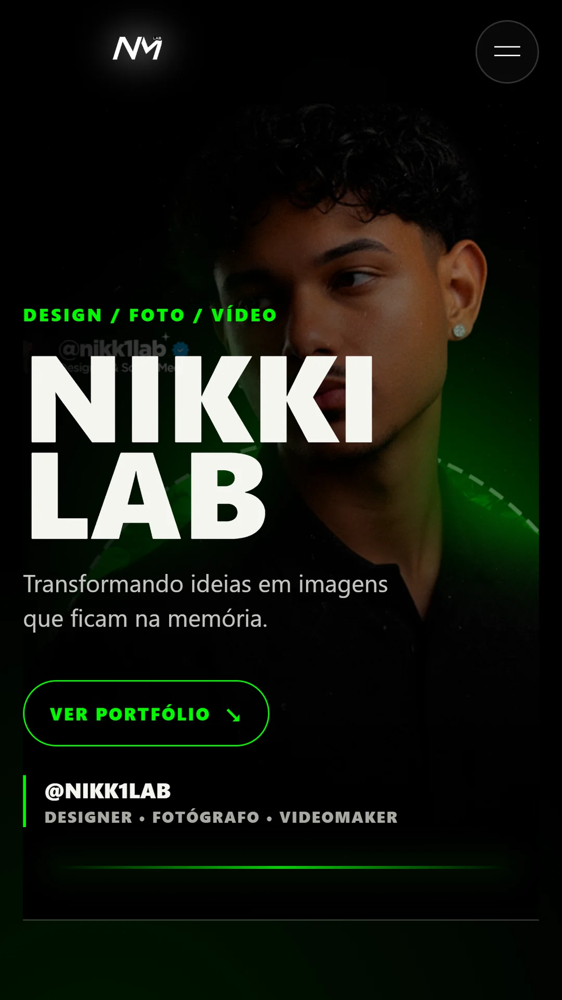

# Nikki Lab

Portfólio de Nicolas Melo, com trabalhos de design, identidade visual, fotografia e produção audiovisual.

[Acessar o portfólio](https://ihatenikki.github.io/nikki-lab-portfolio/) · [TRELLA Group](https://trellagroup.com.br/)



## O projeto

Site estático desenvolvido com HTML, CSS e JavaScript, com navegação por seções, galeria de trabalhos e links de contato. A identidade visual combina preto e verde, com animações de entrada e efeito de parallax.

- Layout responsivo e menu para dispositivos móveis.
- Galeria gerada em JavaScript a partir da lista `portfolioImages`.
- Carregamento adiado das imagens da galeria.
- Links para Instagram, WhatsApp e Behance.

## Estrutura

```text
assets/       Imagens e identidade visual
index.html    Conteúdo e navegação
style.css     Estilos e regras responsivas
script.js     Galeria, menu e interações
```

## Executar localmente

Com Node.js e npm instalados, execute na pasta do projeto:

```sh
npx --yes http-server . -p 8080 -c-1
```

Abra [localhost:8080](http://localhost:8080). O site não precisa de compilação nem de instalação de dependências para produção.

Para atualizar os trabalhos, edite a lista `portfolioImages` em `script.js` e adicione os arquivos correspondentes em `assets/`.

## Publicação

O GitHub Pages publica a raiz (`/`) da branch `main`. Os caminhos relativos dos arquivos permitem a execução em `https://ihatenikki.github.io/nikki-lab-portfolio/`.

## Créditos

Nikki Lab — Nicolas Melo. Desenvolvimento web creditado à [TRELLA Group](https://trellagroup.com.br/) no site.
